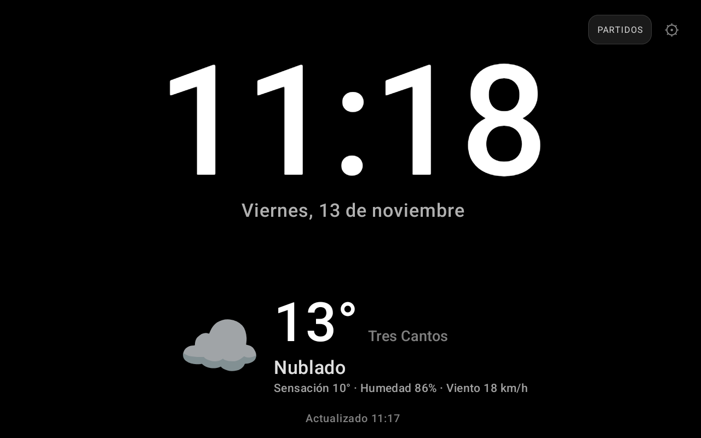
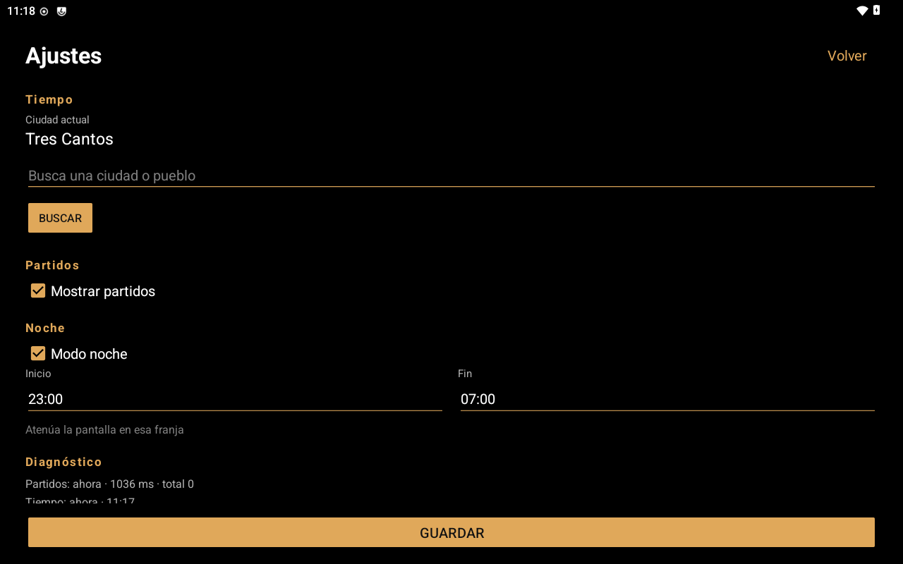
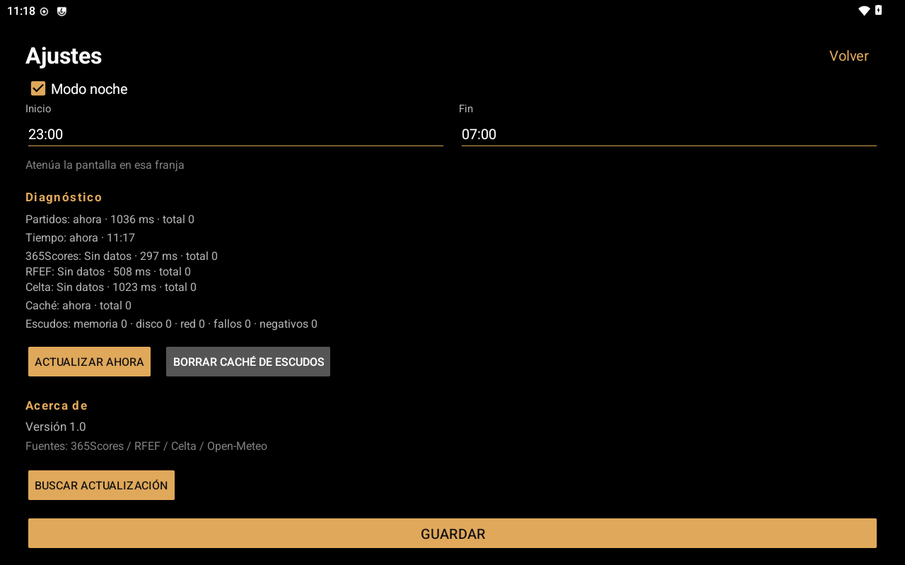
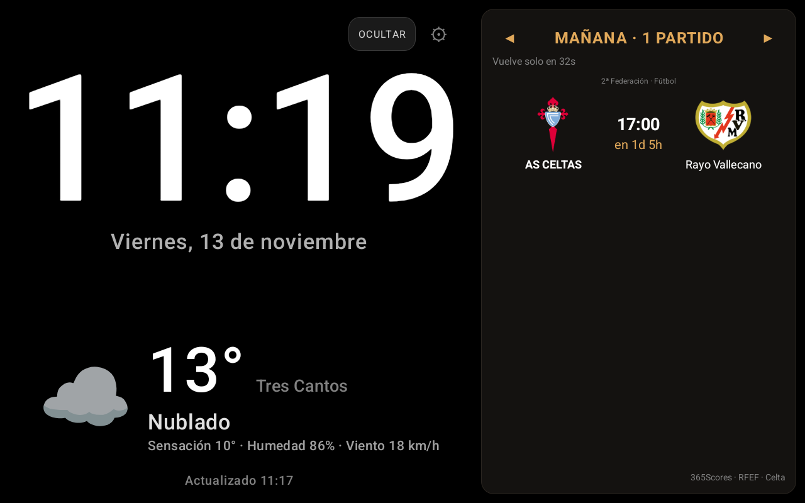

# HomeClock — Reloj y tiempo para Movistar Home

App Android ligera para un **Movistar Home RG3205W** en horizontal. Muestra un reloj grande, el tiempo actual y los partidos de los equipos seguidos. Está escrita en Java, sin AndroidX ni dependencias externas, y funciona sin cuenta ni backend propio.



## Funciones

- **Reloj** grande `HH:mm` y fecha en español.
- **Tiempo actual** con Open-Meteo: temperatura, sensación, humedad y viento.
- **Varias ciudades guardadas** con una sola petición para todas; se cambia de ciudad deslizando en el bloque de tiempo.
- **Primera ciudad por IP al iniciar la app**, sin GPS ni permisos: si ya estaba guardada se mueve al primer puesto y, si es nueva, se añade delante sin borrar ninguna. También hay un botón manual **Usar mi ubicación**.
- **Buscador de ciudades y pueblos**; no hay que escribir latitud ni longitud.
- **Modo noche** configurable: atenúa la pantalla en una franja horaria.
- **Panel de partidos** con escudos, marcador y estado:
  - Fútbol: Real Madrid, Rayo Vallecano, España y Liverpool.
  - Baloncesto: Real Madrid (ACB y Euroliga).
  - Celta Femenino (As Celtas) vía RFEF y la web del Celta.
- **Minuto real de la API**, sin reloj local inventado: `34'`, `90+4'`, `4C 00:03`.
- **Refresco adaptativo**: 15 s en baloncesto, 5 s en los últimos 2 min de cuarto, 60 s en fútbol y 6 h sin partidos.
- **Navegación por días** en el panel con ◀ ▶ y vuelta automática a hoy.
- **Diagnóstico** en Ajustes: última actualización, latencia, estado por fuente, caché y contadores de escudos.
- **Actualizaciones** desde GitHub Releases: comprobación diaria, descarga, SHA-256 y un toque en el instalador.
- **Pixel shift** cada 5 minutos para reducir la retención de pantalla.

## Capturas

| Ajustes | Diagnóstico | Partidos |
|---|---|---|
|  |  |  |

## Requisitos

- Android 8.0 o superior (`minSdk 26`).
- Pantalla horizontal.
- Conexión a Internet para el tiempo y los partidos.
- Para compilar: JDK 17 y Android SDK 35. No hace falta instalar Gradle: el wrapper está incluido.

## Instalar

Descarga el APK de la última release:

```bash
adb install -r homeclock-1.0.apk
```

La primera vez que la app se actualice a sí misma, Android pedirá permitir “Instalar apps desconocidas” para HomeClock. Es un ajuste único.

## Compilar

```bash
./gradlew assembleDebug
./gradlew assembleRelease
```

APKs:

- `app/build/outputs/apk/debug/app-debug.apk`
- `app/build/outputs/apk/release/app-release.apk`

### ¿Hacen falta `gradlew` y `gradle/wrapper` en el repo?

Sí. El wrapper fija Gradle 8.5 y permite que cualquiera compile con `./gradlew` sin instalar Gradle. Es el estándar en proyectos Android y también lo usa la CI. No contiene secretos: el keystore y sus contraseñas están fuera del repositorio (`keys/`, ignorado por git).

## Ajustes

- **Ciudades**: lista editable (hasta 8). Se añaden con el buscador, se seleccionan tocando una fila y se reordenan o eliminan con los botones. La primera es la ciudad actual y se actualiza al abrir la app; **Usar mi ubicación** fuerza la detección por IP. La seleccionada se conserva entre arranques.
- **Partidos**: mostrar u ocultar el panel.
- **Noche**: activar y definir inicio/fin (`HH:mm`). La franja puede cruzar medianoche. Si inicio y fin coinciden, no se aplica.
- **Diagnóstico**: última actualización, latencia, estado de cada fuente, antigüedad de la caché, contadores de escudos y botones **Actualizar ahora** y **Borrar caché de escudos**.
- **Acerca de**: versión, fuentes y **Buscar actualización**.

## Actualizaciones

La app consulta una vez al día:

```text
https://github.com/IgTriguero/Movistar-Home-Clock/releases/latest/download/update.json
```

Si hay una versión con `versionCode` mayor:

1. Descarga el APK en segundo plano.
2. Verifica su SHA-256.
3. Muestra las notas y pide confirmación.
4. Al pulsar **Instalar**, Android muestra su diálogo final.

Sin *device owner* o root no se puede evitar esa última confirmación del sistema. Tras instalar, Android puede volver al launcher; abre HomeClock de nuevo. Los ajustes se conservan porque se mantiene la misma firma y el mismo `applicationId`.

## Release y CI

- La versión vive en `gradle.properties`: `HOMECLOCK_VERSION_CODE` y `HOMECLOCK_VERSION_NAME`.
- **No se sube la versión durante el desarrollo normal.** Solo se cambia al preparar una release.
- Antes de subirla hay que preguntar si es una versión menor `1.X` (nuevas funciones) o un fix `1.X.Y` (correcciones de la `1.X` actual). El procedimiento completo está en [`docs/RELEASE.md`](docs/RELEASE.md) y el comando `/release`.
- `HOMECLOCK_VERSION_CODE` se incrementa siempre en 1; el tag es `v1.X` o `v1.X.Y` y debe coincidir con `HOMECLOCK_VERSION_NAME`.
- `.github/workflows/android.yml`: tests + lint + APK debug en cada push; al empujar un tag `v*` compila la release firmada, calcula el SHA-256 y publica el APK y `update.json`.
- `.github/workflows/contract.yml`: contrato diario a las 06:17 UTC contra las fuentes reales.
- Secretos del repo: `KEYSTORE_BASE64`, `KEYSTORE_PASSWORD`, `KEY_ALIAS`, `KEY_PASSWORD`.
- Flujo: pregunta y confirmación de versión → tests/lint → actualizar `gradle.properties` → commit → tag → `git push origin main --tags` → verificar workflow.

Guarda una copia de `keys/homeclock-release.jks` y sus contraseñas. Sin esa clave no se pueden publicar actualizaciones que instalen encima.

## Calidad

- **322 tests** unitarios con JUnit y fixtures de las fuentes.
- **Contrato diario** contra 365Scores, Open-Meteo, RFEF y Celta.
- **Soak test** de 72 h: `tools/soak.sh` muestrea PID, PSS, actividad en primer plano y crashes/ANRs. Ver [`docs/SOAK.md`](docs/SOAK.md).
- **Lint** sin errores; solo quedan avisos menores de rendimiento/estilo (pesos anidados y carpeta de icono adaptativo).
- Sin AndroidX, sin analítica y sin cuentas.

## Estructura

```text
app/src/main/java/com/itriguero/homeclock/
  MainActivity.java          reloj, tiempo, panel y ciclo de refresco
  SettingsActivity.java      ajustes, lista de ciudades y diagnóstico
  City / CityList            modelo y lista ordenada de ciudades
  IpLocationClient           detección de ciudad por IP (ipwho.is)
  WeatherRepository          fetch multi-ciudad, caché v2 y fallback
  WeatherPager / PageDots    paginador táctil del bloque de tiempo
  MatchRepository.java       orquestación, merge y caché de partidos
  MatchesClient / *Source    fuentes 365Scores, RFEF y Celta
  MatchCache.java            caché JSON por fecha
  LogoLoader.java            escudos en memoria y disco
  Diagnostics.java          último estado para diagnóstico
  UpdateClient/Downloader    comprobación y descarga de releases
  PixelShift.java            desplazamiento anti-retención
app/src/test/                tests y fixtures
docs/                        capturas y guía de soak
tools/                       harness de soak
```

## Fuentes y privacidad

- [Open-Meteo](https://open-meteo.com/) para tiempo y geocoding.
- [ipwho.is](https://ipwho.is/) para estimar la ciudad a partir de la IP pública.
- [365Scores](https://www.365scores.com/) para fútbol y baloncesto.
- [RFEF](https://www.rfef.es/) y la web del Celta para As Celtas.

Son APIs y páginas públicas no oficiales: pueden cambiar sin aviso. La app no usa cuentas ni analítica.

**Detección de ciudad por IP.** Al iniciar la app se consulta `ipwho.is` una vez (hasta tres intentos si falla) para estimar la ciudad a partir de la IP pública; después solo se repite si pulsas **Usar mi ubicación**. No se envía la ubicación del dispositivo, ni identificadores, ni la lista de ciudades: el servicio ve la IP pública y el `User-Agent`, como cualquier web que se visita. La ciudad detectada se guarda como una más, se puede editar o borrar y no sustituye a las ciudades manuales.

El tiempo envía a Open-Meteo las coordenadas de las ciudades guardadas (hasta 8); no se envía la ubicación del dispositivo.

## Ideas y pendientes

El backlog vivo, con la viabilidad técnica de cada propuesta, está en [`docs/BACKLOG.md`](docs/BACKLOG.md).

## Limitaciones

- Los equipos seguidos están fijados en código; la configuración desde la app queda para una versión posterior.
- La detección por IP es aproximada a nivel de ciudad/proveedor y puede fallar con VPN, CGNAT, IP móvil o redes corporativas. La ciudad se puede cambiar a mano.
- La app es solo horizontal y no arranca sola tras un reinicio o un corte de luz.
- No hay *kiosco* ni launcher: se abre a mano.
- Tras una actualización, Android 15 no permite que la app se reabra sola desde el instalador.
- La actualización requiere una confirmación del sistema; el modo totalmente silencioso necesitaría *device owner*.
